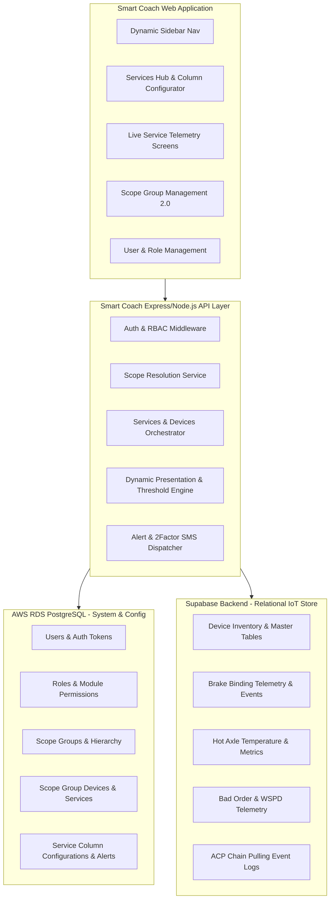
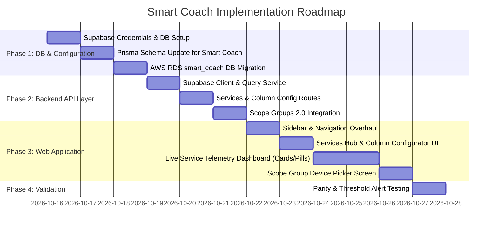

# Smart Coach (SmartCoach) Platform — Architectural Transformation & Implementation Plan

## 1. Executive Summary

This plan details the end-to-end transformation of the **LC Platform (Level Crossing Gate & Cluster system)** into the **Smart Coach (SmartCoach)** IoT application platform. 

The application layer will now manage rolling-stock monitoring services and deployed hardware devices across Indian Railways zones and divisions.

### Core Objectives
1. **Application Rebranding & Scope Shift:** Transition from Level Crossing (LC Gates / Clusters) to Railway Rolling Stock & Passenger Coach Monitoring (**Smart Coach**).
2. **Dual-Database Architecture:**
   - **System & Metadata DB (AWS RDS PostgreSQL):** Handles Users, Roles, Module Permissions, Scope Groups, Column Display Configs, and Alert Rules.
   - **Device & Telemetry DB (Supabase Relational Backend):** Hosts live device inventories, coach telemetry tables, primary key mapping (e.g., `coach_id`), sensor columns, and historical operational data.
3. **Core Services Suite:**
   - **Brake Binding** (Braking anomaly and thermal binding sensors)
   - **Hot Axle** (Axle box temperature & bearing health monitoring)
   - **Bad Order / WSPD** (Wheel Slide Protection & operational defect tracking)
   - **ACP (Alarm Chain Pulling)** (Emergency brake chain pull detection and event logging)
4. **Dynamic Sidebar & Navigation:**
   - Removal of legacy *Clusters* and *LC Gates* navigation links.
   - Introduction of the **Services** hub (service registry, device mapper, and column presentation designer).
   - Dynamic registration of individual service items directly in the sidebar navigation (e.g., **Brake Binding**, **Hot Axle**, **Bad Order**, **ACP**) for instant operator data drilldown.
5. **Dynamic Column & Presentation Customizer:**
   - Administrators can inspect tables per device/service.
   - Choose which attributes/columns to display to end operators (ignoring unnecessary raw telemetry).
   - Choose rendering style: **Cards**, **Pills**, **KPI Badges**, or **Data Tables**.
   - **Performance Gradients:** Visual color mapping (e.g., Green for nominal/good performance $\rightarrow$ Yellow for warning $\rightarrow$ Red for critical).
   - **Condition Triggers & Alerts:** Rule engine to define threshold values (e.g., Axle Temp $> 85^\circ\text{C}$ or ACP Event triggered) to generate visual notes, in-app notifications, and dispatch SMS alerts via 2Factor gateway.
6. **Scope Groups 2.0 (Service & Device Access Control):**
   - Replace gate/cluster mapping with **Service $\rightarrow$ Device** scope assignments.
   - Hierarchical zonal/divisional access (e.g., *Central Railway* Zonal Officer accesses 5 Bad Order devices in CR, while *Western Railway* accesses 5 Bad Order devices in WR).

---

## 2. Dual Database Architecture



---

## 3. Database Schema & Data Models

### 3.1. AWS RDS (`smart_coach` PostgreSQL Database)

The existing database will maintain the robust user authentication, auditing, and scope hierarchy, while migrating cluster tables to service configuration models:

```prisma
// Retained & Enhanced System Models
model User {
  id                  Int               @id @default(autoincrement())
  fullName            String
  mobile              String            @unique
  email               String            @unique
  employeeId          String            @unique
  department          String
  passwordHash        String
  roleId              Int?
  role                Role?             @relation(fields: [roleId], references: [id])
  status              String            @default("PENDING")
  scopeGroups         ScopeGroupUser[]
  createdAt           DateTime          @default(now())
  updatedAt           DateTime          @updatedAt
}

// Scope Group 2.0: Maps to Services and Devices instead of Clusters
model ScopeGroup {
  id          Int                  @id @default(autoincrement())
  name        String               @unique
  description String?
  color       String?              @default("#0B3C7A")
  parentId    Int?
  parent      ScopeGroup?          @relation("ScopeGroupHierarchy", fields: [parentId], references: [id], onDelete: Cascade)
  children    ScopeGroup[]         @relation("ScopeGroupHierarchy")
  devices     ScopeGroupDevice[]
  users       ScopeGroupUser[]
  createdAt   DateTime             @default(now())
  updatedAt   DateTime             @updatedAt
}

model ScopeGroupDevice {
  id           Int        @id @default(autoincrement())
  scopeGroupId Int
  scopeGroup   ScopeGroup @relation(fields: [scopeGroupId], references: [id], onDelete: Cascade)
  serviceSlug  String     // 'brake-binding' | 'hot-axle' | 'bad-order' | 'acp'
  deviceId     String     // Hardware / Device identifier in Supabase
  assignedAt   DateTime   @default(now())

  @@unique([scopeGroupId, serviceSlug, deviceId])
  @@index([scopeGroupId])
  @@index([serviceSlug, deviceId])
}

// Dynamic Service Presentation & Column Customization Configuration
model ServiceColumnConfig {
  id            Int      @id @default(autoincrement())
  serviceSlug   String   // 'brake-binding', 'hot-axle', etc.
  tableName     String   // Table in Supabase
  columnKey     String   // Column name
  displayName   String   // User-friendly label (e.g., "Axle 1 Temp (°C)")
  dataType      String   // 'number' | 'string' | 'boolean' | 'timestamp'
  displayStyle  String   // 'card' | 'pill' | 'badge' | 'table-column'
  isVisible     Boolean  @default(true)
  isPrimaryKey  Boolean  @default(false) // e.g. coachId
  sortOrder     Int      @default(0)
  
  // Performance Gradient Styling
  gradientEnabled Boolean @default(false)
  minGoodValue    Float?  // Nominal / Green
  maxGoodValue    Float?
  warningValue    Float?  // Amber / Caution
  criticalValue   Float?  // Red / Danger
  
  // Alert & Notification Triggers
  alertTriggerType String? // 'NONE' | 'GREATER_THAN' | 'LESS_THAN' | 'EQUALS'
  alertThreshold   String? // Trigger value
  alertMessage     String? // Notification message template
  sendSms          Boolean @default(false)
  
  createdAt     DateTime @default(now())
  updatedAt     DateTime @updatedAt

  @@unique([serviceSlug, tableName, columnKey])
}
```

### 3.2. Supabase Relational Database Architecture

The Supabase instance stores live IoT telemetry and device records structured around the 4 core railway services:

1. **`devices` / Inventory Table:**
   - `device_id` (Primary Key, e.g., `DEV-BB-001`)
   - `service_slug` (`brake-binding`, `hot-axle`, `bad-order`, `acp`)
   - `coach_id` / `coach_number` (e.g., `CR-WGACCW-21345`)
   - `zone` (e.g., `Central Railway`)
   - `division` (e.g., `Mumbai CR`)
   - `status` (`ONLINE`, `OFFLINE`, `ALERT`)
   - `installed_at`, `last_telemetry_at`
2. **`telemetry_brake_binding`:**
   - `id`, `device_id`, `coach_id`, `brake_cylinder_pressure`, `lining_temperature`, `air_flow_rate`, `speed_kmph`, `timestamp`
3. **`telemetry_hot_axle`:**
   - `id`, `device_id`, `coach_id`, `axle_1_temp`, `axle_2_temp`, `axle_3_temp`, `axle_4_temp`, `ambient_temp`, `diff_temp`, `bearing_vibration`, `timestamp`
4. **`telemetry_bad_order`:**
   - `id`, `device_id`, `coach_id`, `wspd_active`, `wheel_slide_detected`, `fault_code`, `speed_sensor_status`, `isolation_valve_state`, `timestamp`
5. **`telemetry_acp`:**
   - `id`, `device_id`, `coach_id`, `chain_pulled_status`, `pressure_drop_rate`, `cabin_location`, `event_time`, `reset_time`

---

## 4. UI/UX Design & Dynamic Navigation Specifications

### 4.1. Sidebar Navigation
- **Removed:**
  - `LC Gates`
  - `Clusters`
- **Added:**
  - **Services (Hub):** Management portal for inspecting Supabase tables, setting active columns, defining visual indicators, and configuring threshold alerts.
  - **Dynamic Service Items (Auto-populated):**
    - 🛑 **Brake Binding**
    - 🌡️ **Hot Axle**
    - ⚠️ **Bad Order**
    - 🔔 **ACP (Alarm Chain Pulling)**
- **Retained & Seamless:**
  - 📂 **Scope Groups** (Device & Service assignment)
  - 👥 **Manage Users**
  - 📝 **Registration Builder**
  - 🛡️ **Roles**
  - 🎨 **Branding**

### 4.2. Column Customizer & Visual Presentation System
When an administrator configures a service (e.g., *Hot Axle*):
1. **Introspection:** The system queries Supabase for table schemas and columns.
2. **Selection:** The admin checks off which columns the end users should see (e.g., `coach_id`, `axle_1_temp`, `diff_temp`, `speed_kmph`).
3. **Display Format:**
   - **Card:** Large KPI card with gradient background and metric value.
   - **Pill:** Compact rounded tag with icon and status color.
   - **Table View:** Grid column with sorting and filtering.
4. **Gradient & Threshold Rules:**
   - Nominal temperature ($\le 65^\circ\text{C}$): Vibrant Green.
   - Elevated temperature ($66^\circ\text{C} - 80^\circ\text{C}$): Amber warning.
   - Critical temperature ($> 80^\circ\text{C}$): Crimson Red with pulsing animation.
5. **Automated Notification Triggers:**
   - When a telemetry packet crosses the threshold, an in-app audit log / notification is generated, and an automated SMS can be triggered via the configured 2Factor DLT template.

### 4.3. Scope Groups 2.0 Integration
- During Scope Group creation/editing:
  1. Select Zone / Division.
  2. Select the **Service** (e.g. *Bad Order*).
  3. The list of deployed devices for that service appears with coach ID and location details.
  4. Select device IDs to associate with the scope group.
- Users assigned to that Scope Group will only see data from those designated devices when visiting that service screen.

---

## 5. API Endpoints Contract

| Method | Endpoint | Description |
|---|---|---|
| `GET` | `/api/v1/services` | List all available Smart Coach services with device counts and statuses |
| `GET` | `/api/v1/services/:slug/schema` | Introspect Supabase tables & columns for a specific service |
| `GET` | `/api/v1/services/:slug/config` | Get configured display columns, cards, gradients, and alert thresholds |
| `POST` | `/api/v1/services/:slug/config` | Update column visibility, display styles, gradients, and alert rules |
| `GET` | `/api/v1/services/:slug/data` | Fetch live telemetry rows from Supabase, filtered by user's Scope Group devices |
| `GET` | `/api/v1/services/:slug/devices` | Fetch device inventory for scope assignment |
| `POST` | `/api/v1/scope-groups` | Create scope group with `serviceDevices: [{ serviceSlug, deviceId }]` |
| `PUT` | `/api/v1/scope-groups/:id` | Update scope group with service devices |
| `GET` | `/api/v1/scope-groups/my-scope` | Returns accessible device IDs grouped by service |

---

## 6. Implementation Phases


